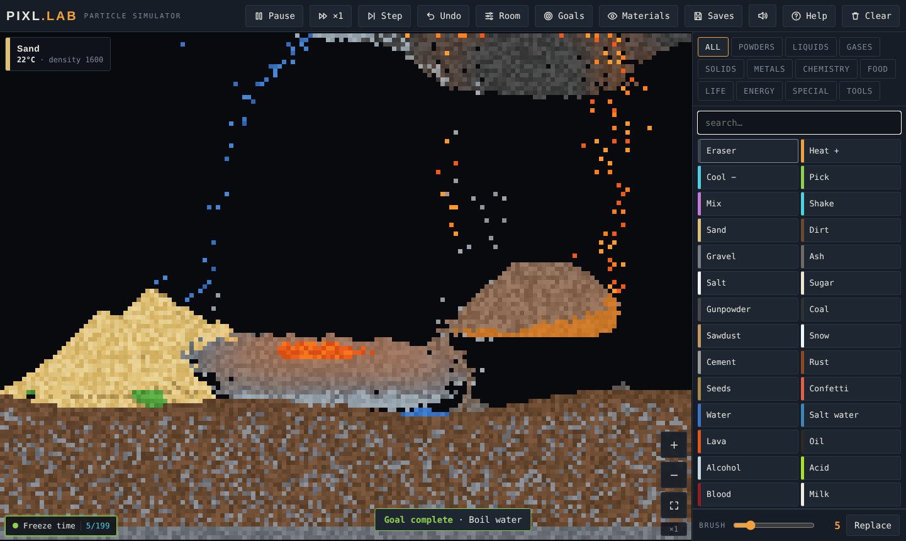
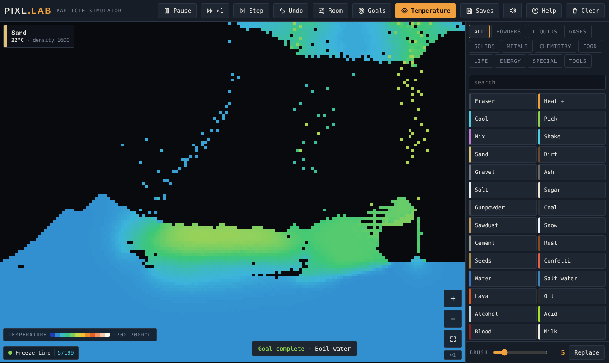
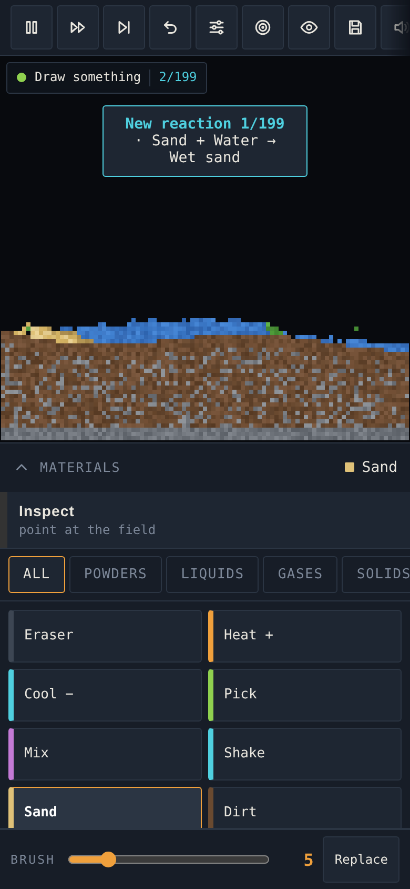

<div align="center">


# PIXL.LAB

**A falling-sand particle simulator that runs in any browser.**
Pour, burn, melt, freeze, electrify — and discover how 270+ materials react to each other.

Made by [**@gexhaw**](https://github.com/gexhaw)

[](https://gexhaw.github.io/pixl.lab/)
[](LICENSE)




</div>

---

## Features

| | |
|---|---|
| **271 materials** | Powders, liquids, gases, solids, metals, chemistry, food, life, energy and exotic stuff like antimatter, gray goo and black holes |
| **199 reactions** | Salt dissolves in water, acid eats metal, yeast ferments sugar, tin + molten copper makes bronze… every one you trigger goes into your collection |
| **Real heat** | Every cell has a temperature. Heat conducts, materials melt, boil, freeze and condense at their own thresholds |
| **Electricity & light** | Batteries, wires, lamps, fuses, resistors, capacitors, solar panels, lasers, mirrors and prisms |
| **Living things** | Plants grow toward water, bugs eat, fish swim, bees make honey, spiders weave webs, frogs hunt flies |
| **Room settings** | Ambient temperature, gravity (including zero and reversed), wind and heat flow, with presets: Moon, Space, Arctic, Inferno, Upside down… |
| **Lab notebook** | 20 goals that teach the mechanics, plus a reaction collection with hints and a free recipe reveal |
| **3 view modes** | Materials, heat map, flammability map |
| **Saves** | Autosave and 3 slots in `localStorage`, undo for the last 12 strokes |
| **Mobile-ready** | Touch drawing, pinch-zoom, two-finger pan, adaptive portrait layout |

<p align="center">
  
  &nbsp;
  
</p>

## Quick start

No build step and no dependencies — it is plain HTML, CSS and JavaScript.

```bash
git clone https://github.com/gexhaw/pixl.lab.git
cd pixl.lab
```

Then open `index.html` in a browser, or serve the folder:

```bash
python3 -m http.server 8080
# → http://localhost:8080
```

## Controls

| Action | Mouse / keyboard | Touch |
|---|---|---|
| Draw | Left drag | One finger |
| Pan | Right / middle drag, or `Shift` + drag | Two fingers |
| Zoom | Wheel, `+` / `-`, `0` to reset | Pinch, `+` / `−` buttons |
| Pause / play | `Space` | ⏸ button |
| Step one frame (paused) | `.` | Step button |
| Speed ×0.25 … ×4 | `,` / `.` | ⏩ button |
| Brush size | `[` / `]` | Slider |
| Undo | `Ctrl` / `⌘` + `Z` | ↶ button |
| View mode | `V` | 👁 button |
| Room settings | `R` | Room button |
| Goals | `G` | ◎ button |
| Mute | `M` | 🔊 button |
| Close any window | `Esc` | ✕ |

## Project structure

```
pixl.lab/
├── index.html        markup and script loading order
├── favicon.svg
├── css/
│   └── style.css     UI, responsive layout (desktop / tablet / phone)
├── js/
│   ├── elements.js   material table (DEF), tools, reaction table (RXDEF)
│   ├── engine.js     grid, movement, heat, phase changes, reactions, explosions
│   ├── render.js     canvas drawing, view modes, camera, pointer input, undo
│   └── app.js        UI, audio, room, goals, lab notebook, saves, main loop
└── docs/             screenshots
```

Scripts are classic (non-module) and share globals, so they load in order: `elements → engine → render → app`.

## How it works

- The world is a grid of cells stored in typed arrays: `type`, `temp`, colour channels, per-cell `dat` (lifetime, direction, cloned id…) and `burn` timers.
- Each step scans rows against gravity, alternating left/right per row so piles stay symmetric. An `upd` mask makes sure a moved cell is processed once per step.
- For every cell: heat exchange with one random neighbour → burning → phase change (`tH`/`tL`) → reaction with one random neighbour → special behaviour → movement by type (`p` powder, `l` liquid, `g` gas, `b` crawler, `f` swimmer, `y` flyer, `r` burrower, `e` electricity, `m` light).
- Density decides who sinks through whom; viscosity and stickiness slow liquids down.
- Reactions are a hash map keyed by `a*512+b`, registered in both directions.
- Cell size adapts to the screen, and drops automatically if FPS falls below ~28.

## Adding a material

Add an entry to `DEF` in [`js/elements.js`](js/elements.js):

```js
{k:'glowstone', c:'solid', n:'Glowstone', col:['#f2d35a','#e0c24c'],
 den:2200, mv:'s', glow:.8, tH:1400, sH:'lava'}
```

| Key | Meaning |
|---|---|
| `k`, `n`, `c` | id, display name, palette category |
| `col` | 1–5 colours, picked at random per cell |
| `mv` | movement: `p` `l` `g` `s` `w` `b` `f` `y` `r` `e` `m` |
| `den` | density, kg/m³ (`9e9` = immovable) |
| `tH` / `sH`, `tL` / `sL` | melt/boil and freeze/condense temperature and result |
| `fl`, `bt`, `bto`, `bT` | flammability 0–1, burn ticks, burn residue, burn temperature |
| `hot`, `cond`, `ins` | spawn temperature, heat conductivity, insulator |
| `exp`, `wexp` | explosion radius on burnout / on contact with water |

…and a reaction to `RXDEF`: `['a', 'b', resultA, resultB, chance]` (`''` = empty cell).

New saves stay compatible as long as you **append** materials to the end of `DEF` — ids are positional.

## Contributing

Issues and pull requests are welcome — see [CONTRIBUTING.md](CONTRIBUTING.md).

## License

[MIT](LICENSE) © 2026 Ruben Nugmanov ([@gexhaw](https://github.com/gexhaw))
